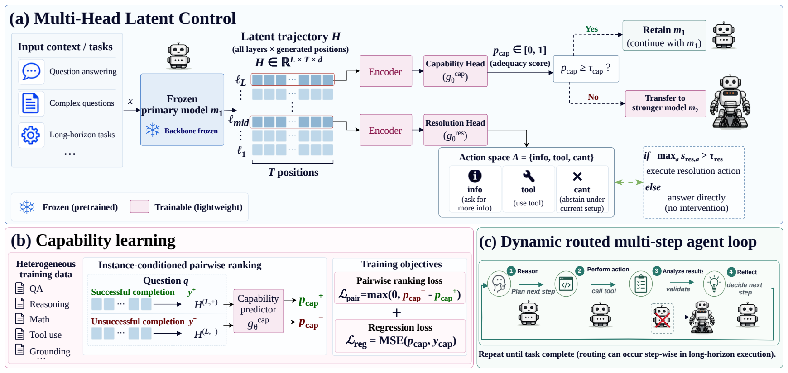
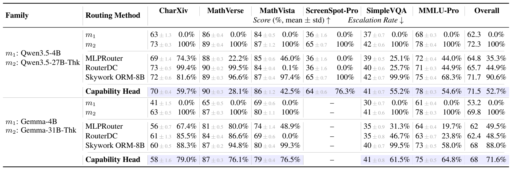

# Multi-Head Latent Control (MHLC) router

Multi-Head Latent Control (MHLC) helps an initial model handle the questions it can answer and routes the remaining questions to a configured fallback. The initial model generates an answer, and a lightweight **Capability Head** reads its hidden states to estimate whether the answer is correct. LLMRouter returns the answer when the score meets your threshold. Otherwise, it sends the original question to the fallback model.

Use a head trained for the initial model and configure the fallback for your deployment. The threshold lets you balance answer quality and fallback usage.

- **Selective handoff.** Return answers the initial model is likely to get right and call the fallback for answers the head scores below the threshold.
- **Lightweight training.** Train the head on graded answers while keeping the language model frozen. The included Qwen3.5-4B recipe trains **2.86M parameters**.
- **Strong results across domains.** The paper evaluates chart understanding, visual math, GUI grounding, visual question answering, and general knowledge. MHLC outscored MLPRouter and RouterDC on most reported Qwen and Gemma tasks and was competitive with Skywork ORM-8B.
- **Complete pipeline.** Generate answers, label correctness, train a head, and route questions. You can also train on answers you have already graded.

For inference, the same vLLM engine replays the completed chat to extract hidden states. The head then produces a score between 0 and 1 without a separate LLM judge. Accepted answers require no fallback call.

[Models and weights](#models-and-weights) · [Model confidence](#how-does-mhlc-compare-with-model-confidence) · [Routing results](#routing-results-from-the-paper) · [Installation](#installation) · [GPU quickstart](#gpu-quickstart) · [Train a head](#run-the-mixed-source-pipeline) · [Route a question](#route-a-question) · [Citations](#citing-mhlc-and-gnosis)



*Figure 1 from the revised MHLC manuscript.* The diagram shows both MHLC heads. LLMRouter uses the Capability Head for the handoff decision. [arXiv preprint](https://arxiv.org/abs/2607.14277) · [Original implementation](https://github.com/Amirhosein-gh98/Multi-Head-Latent-Control)

## Models and weights

- **LLMRouter preset.** Train a vLLM-native Capability Head for **Qwen3.5-4B** and route to **Qwen3.5-9B** as the fallback. The preset accepts text and image inputs. [Training and routing config](../../../configs/model_config_train/gnosis_qwen35_4b.yaml)
- **Pretrained MHLC weights.** The original implementation provides **12 head checkpoints** for **Qwen3-VL** (2B, 4B, and 32B), **Qwen3.5** (4B and 9B), and **Gemma 4 E4B**. Use the original runtime with the checkpoint for your backbone and thinking mode. [Download the weights](https://huggingface.co/collections/AmirhoseinGH/multi-head-latent-control-capability-heads) · [Checkpoint and model variants](https://github.com/Amirhosein-gh98/Multi-Head-Latent-Control#pretrained-capability-heads)

## How does MHLC compare with model confidence?

Token confidence measures how probable the model found the words it generated. Logit entropy measures how uncertain it was when choosing the next token. A model can score highly on token confidence and still give the wrong answer. On ScreenSpot-Pro, correct and incorrect Qwen3.5-9B answers had substantially overlapping token-confidence scores. The Capability Head separated the two groups more clearly. [Token-confidence distributions in the MHLC preprint](https://arxiv.org/html/2607.14277v1#A2.F4)

In the revised manuscript, the head improved final answer quality and used the larger model less often in both model families. [Original confidence comparison, Table 11](assets/mhlc-confidence-baselines.png)

- **Qwen3.5-4B → 27B-Thinking, six benchmarks.** MHLC scored **71.5 out of 100** and sent **52.7%** of questions to the larger model. Routing by token confidence or by logit entropy scored **69.0** and sent **90.0%** in each case. That is **2.5 points higher with about 37 fewer calls to 27B per 100 questions**, on average.
- **Gemma-4B → 31B-Thinking, five benchmarks.** MHLC scored **68.0** and sent **71.6%** of questions to the larger model. Token confidence scored **64.0** and sent **90.1%**. Logit entropy scored **65.0** and sent **89.8%**.

## Routing results from the paper

The revised manuscript reports results for Qwen and Gemma model pairs across **CharXiv, MathVerse, MathVista, ScreenSpot-Pro, SimpleVQA, and MMLU-Pro**. As one example, the Qwen comparison below averages all six benchmarks equally. MHLC came within **0.8 points** of sending every question to Qwen3.5-27B-Thinking. It also came within **0.2 points** of the Skywork ORM-8B verifier, which sent **90.6%** of questions to the larger model.

| Routing method | Answer quality (score out of 100) | Questions sent to the larger model (Qwen3.5-27B) |
| --- | ---: | ---: |
| Qwen3.5-4B alone | 62.3 | 0.0% |
| MLPRouter | 64.8 | 35.3% |
| RouterDC | 65.7 | 44.9% |
| Token confidence | 69.0 | 90.0% |
| Logit entropy | 69.0 | 90.0% |
| **MHLC Capability Head** | **71.5** | **52.7%** |
| Skywork ORM-8B | 71.7 | 90.6% |
| Qwen3.5-27B-Thinking alone | 72.3 | 100.0% |

On Gemma, MHLC matched Skywork ORM-8B’s **68.0** while sending **71.6%** of questions to the larger model, compared with Skywork’s **88.0%**.



*Table 2 from the revised MHLC manuscript.* Each task column gives the score and escalation rate, averaged over three runs. The overall columns weight each benchmark equally. The paper used a Capability Head threshold of 0.8. [Open the full-size table](assets/mhlc-routing-results.png)

**What does scoring cost?** The revised manuscript (p. 8) measured its roughly 5M-parameter head at **4.11 ms per answer** with cached hidden states, compared with **104.18 ms** for the Skywork ORM-8B verifier. Both timings used one A100 80 GB, batch size one, and 12 examples. In this integration, the local vLLM replay adds feature-extraction time before the head runs.

The LLMRouter example below benchmarks Qwen3.5-4B with a Qwen3.5-9B fallback on TriviaQA and starts with a threshold of 0.5.

## Installation

Run the examples below from an LLMRouter checkout on Linux with a vLLM-compatible CUDA GPU. The registered router name is `gnosis_latent_router` and its CLI alias is `mhlc`. Install its GPU extra in a dedicated environment because RouterR1 pins a different vLLM version.

```bash
python3.12 -m venv venv
source venv/bin/activate
python -m pip install -e ".[gnosis]"
```

The full preset loads Qwen3.5-4B for generation and training, a 30B-A3B FP8 judge for labels requiring judgment, and Qwen3.5-9B as the benchmark fallback. Select hardware that supports the judge's dtype or set `--judge-model-id` and `--judge-revision` to an appropriate instruction model and record that choice with your results. Use `HF_HOME` to place model and dataset downloads on a disk with sufficient space. All pipeline commands use the active Python interpreter unless `pipeline.python` is set.

## GPU quickstart

Try the whole pipeline with two labeled answers. The example builds a tiny Qwen3.5 model that always answers `4`. It gets `2 + 2` right and `2 + 3` wrong. The example grades both answers, trains the head, and then shows its routing decision for a third question. It downloads only the tokenizer and model configuration.

```bash
work=$(mktemp -d)
python examples/mhlc/prepare_smoke.py "$work"
llmrouter mhlc run --config "$work/router.yaml" --query "What is 3 + 1?" --route-only
```

For an offline run, pass `--source /path/to/Qwen3.5-4B-snapshot` to the preparation script. Set `--gpu-memory-utilization` there to adjust the fraction of GPU memory available to each smoke stage. The final output includes a selected model and a capability score. Inspect `$work/run/verified/` for the labels and `$work/head/aux_head_final.pt` for the trained head.

## Run the mixed-source pipeline

Use a new workspace for each model, thinking mode, or source selection. Set the same workspace for training and inference. The workspace defaults to the checkout for the supplied preset.

```bash
export GNOSIS_WORKSPACE="$PWD/mhlc-workspace"
mkdir -p "$GNOSIS_WORKSPACE"
config=configs/model_config_train/gnosis_qwen35_4b.yaml

# Show the resolved commands and paths.
llmrouter mhlc run --config "$config" --dry-run

# Run all four stages in order.
llmrouter mhlc run --config "$config"
```

| Stage | Input and operation | Output in the workspace |
| --- | --- | --- |
| `generate` | Selects 40,000 questions across FineVision, MM-OpenR1, DAPO-Math, TriviaQA, AGUVIS, and APIGen. Generates candidates with the pinned Qwen3.5-4B revision and thinking off. | `{run_root}/raw/*.parquet`, selection manifest, generation statistics |
| `label` | Applies source-specific rules and uses a local Qwen judge when the rules require judgment. Preserves the prompt, images, completion, source identifiers, and continuous correctness score. | `{run_root}/verified/*.parquet`, verification statistics |
| `train` | Replays the completed chat, aligns processor token IDs to vLLM hidden states, and optimizes the Capability Head with weighted mean squared error. | Periodic checkpoints, `aux_head_final.pt`, and the effective training config in the recipe's `output_dir` |
| `benchmark` | Compares the target alone, fallback alone, and threshold-based handoff on the TriviaQA validation split. | Per-strategy generations, scores, summaries, and run manifest under `eval_outputs/` |

Run any stage individually, for example `llmrouter mhlc label --config "$config"`. Standard training is also available through `llmrouter train --router mhlc --config "$config"`. Each subprocess streams its output to the terminal and appends it to `logs/gnosis/<stage>.log` in the workspace.

Generation and labeling resume from completed Parquet shards. Keep the source selection, model revision, and judge consistent across retries. If a judge request exceeds its context or produces an unusable score, inspect the stage log and adjust the judge settings before retrying. For legacy raw shards without generation provenance, use them as labeling input or start generation in a fresh workspace.

## Route a question

```bash
llmrouter infer --router mhlc --config "$config" --route-only \
  --query "Why do eclipses happen?"
```

Route-only still runs local generation and head scoring. The result includes `model_name`, `candidate_response`, `gnosis_score`, `threshold`, and `accepted`. To receive the final answer, omit `--route-only`. Accepted candidates are returned immediately. On escalation, LLMRouter sends the question to the fallback endpoint.

The example catalog points at an OpenAI-compatible local service at `http://localhost:8000/v1` serving `Qwen/Qwen3.5-9B`. Start that service on hardware with room for the fallback, or edit `data_path.llm_data` and its catalog entry to point to your deployment. For a local service without authentication, set `export API_KEYS='{"local":[""]}'`. [Example model catalog](../../../data/gnosis_latent_router_llm_data.json)

Choose the threshold on held-out questions from the intended deployment. A higher threshold escalates more requests. Report the accepted fraction and final answer quality alongside fallback usage. The example threshold of 0.5 is a starting value.

## Data, recipes, and checkpoints

- **Custom raw inputs.** Add `--source <name>` and `--source-file /path/to/file.parquet` to the generation command in a copied config. Use the selected source's schema. The smoke example demonstrates DAPO's `prompt` and `solution` fields. TriviaQA uses `question` and `answer.value`. Without a local file, the generator loads the selected source from Hugging Face.
- **Already labeled inputs.** Set the training recipe's `dataset_path` to a verified Parquet directory, Hugging Face dataset saved to disk, or a JSON/JSONL file. A text record can contain `{"question": "What is 2 + 2?", "completion": "4", "correctness_score": 1.0}`. Multimodal rows also carry `images`. Preserve source-specific fields such as `system_prompt`, `human_prompt`, `tools`, and `context_text` for records that use them.
- **Training recipe.** The default uses the last hidden layer, completion text masking, two epochs, microbatch size 1, gradient accumulation 16, and a learning rate of `1e-4`. To customize, copy the recipe, update `pipeline.variables.training_recipe`, and keep `dataset_path`, `output_dir`, and `pipeline.variables.checkpoint` aligned. The trainer logs optimization-stream metrics. Reserve separate data for evaluation. [Thinking-off recipe](backend/recipes/training/qwen3_5_4b_think_off.yaml)
- **Model changes.** Match the model ID, revision, family, and thinking mode across generation, training, benchmarking, and inference. The packaged thinking-on recipe uses its own 120k run path. Give a new model or mode a new workspace and choose a matching judge and fallback. [Thinking-on recipe](backend/recipes/training/qwen3_5_4b_think_on.yaml)
- **Checkpoint compatibility.** Use a checkpoint produced by this vLLM trainer. The public paper heads use Transformers/Unsloth hidden states, which differ from vLLM's extracted features. Use the original implementation for those weights. The router reads the trained layer selection and token mask from the checkpoint. Version 2 scores answer tokens with the training template and image settings. Existing vLLM version 1 heads retain their original masking behavior. [Source and adaptations](backend/VENDORED_SOURCE.md)

The vLLM connector writes temporary tensors to shared memory and the reader removes them after scoring. Set `GNOSIS_HIDDEN_STATES_DIR` to a fast writable filesystem when shared memory is limited. Set `inference.sampling.max_new_tokens` to cap target generation and `--max-tokens` on the inference command to cap the fallback response. [Full pipeline config](../../../configs/model_config_train/gnosis_qwen35_4b.yaml)

## Citing MHLC and Gnosis

- **MHLC** introduces the Capability Head used by this router and evaluates when to escalate to a larger model. [MHLC paper](https://arxiv.org/abs/2607.14277) · [Original MHLC repository](https://github.com/Amirhosein-gh98/Multi-Head-Latent-Control)
- **Gnosis** studies how a model’s internal signals predict whether its answer is correct. The paper was accepted to **EACL 2027**. [Gnosis paper](https://arxiv.org/abs/2512.20578) · [Original Gnosis repository](https://github.com/Amirhosein-gh98/Gnosis)

```bibtex
@article{ghasemabadi2026multi,
  title={Multi-Head Latent Control: A Unified Interface for LLM Agent Decision Making},
  author={Ghasemabadi, Amirhosein and Chen, Ruichen and Rashidi, Bahador and Niu, Di},
  journal={arXiv preprint arXiv:2607.14277},
  year={2026}
}

@article{ghasemabadi2025can,
  title={Can LLMs predict their own failures? Self-awareness via internal circuits},
  author={Ghasemabadi, Amirhosein and Niu, Di},
  journal={arXiv preprint arXiv:2512.20578},
  year={2025}
}
```
